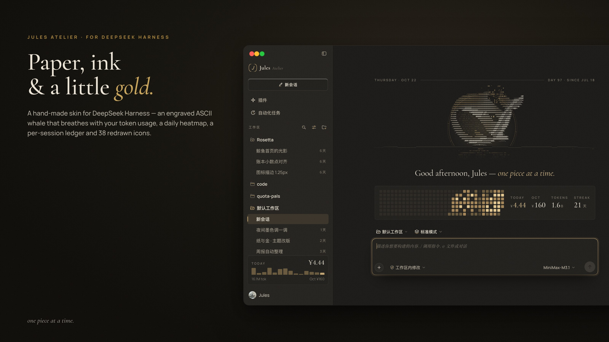
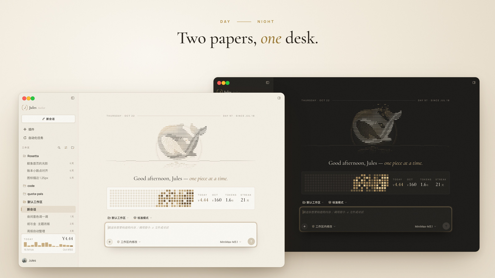
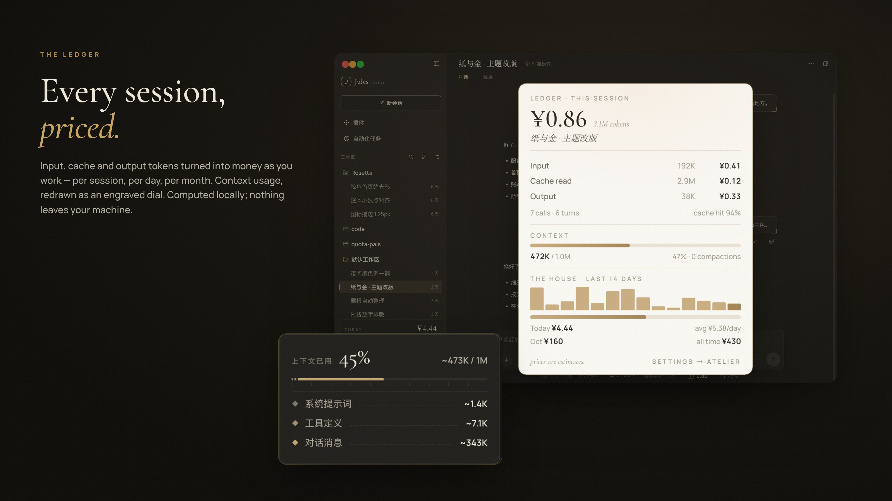
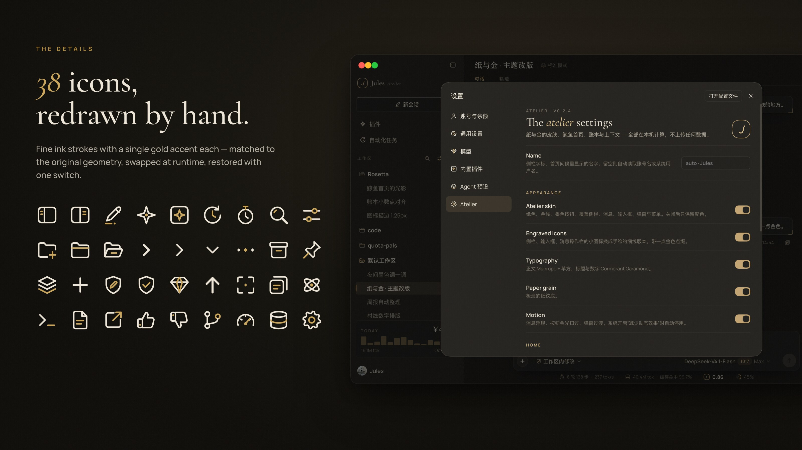

# Jules Atelier — a paper & gold skin for DeepSeek Harness

*Paper, ink & a little gold.* A hand-made theme plugin for DeepSeek Harness desktop.



## What's inside

- **Atelier skin** — warm paper / deep ink palettes that follow the system light & dark mode, thin gold rules, serif display type (Cormorant Garamond) with Manrope for UI text, gentle motion.
- **Engraved ASCII whale** on the new-session page — it breathes, reacts to the cursor, spouts more often the more tokens you use today.
- **Token heatmap** + today / month / tokens / streak at a glance.
- **Per-session ledger** — input, cache-read and output tokens priced per session, per day and per month, plus a 14-day bar chart.
- **Context panel & dial** redrawn: big serif percentage, engraved progress bar, system / tools / messages breakdown.
- **38 engraved icons** — sidebar, composer and message-action icons replaced at runtime with fine-line versions with a single gold accent. One switch restores the originals.
- **Your name** — the sidebar wordmark, monogram and greeting use your account name (or OS user name) automatically; override it in Settings → Atelier → Name.
- **Atelier settings page** — toggle each part, set currency, exchange rate, per-model prices and a daily budget.

Everything is computed **locally** from your session logs in `~/.dsh/sessions`. Nothing leaves your machine. Prices are estimates.

| | |
|---|---|
|  |  |
|  | |

## Install

Requires DeepSeek Harness ≥ 0.2 (bundled `dsh` CLI). Quit Harness first.

```bash
git clone https://github.com/Jules-0409/dsh-jules-atelier ~/dsh-plugins/dsh-jules-atelier

# macOS
DSH="/Applications/DeepSeek Harness.app/Contents/Resources/runtime/cli/bin/dsh"
"$DSH" plugin --profile desktop add "link:$HOME/dsh-plugins/dsh-jules-atelier"
```

On Windows the CLI is `%LOCALAPPDATA%\Programs\DeepSeek Harness\resources\runtime\cli\bin\dsh.cmd`.

Make sure `dsh-jules-atelier` is listed in `dsh.profile.bundles` of `~/.dsh/profiles/desktop/package.json`, then start Harness. Other theme plugins that repaint the UI (e.g. background/theme plugins) may conflict — disable them while trying Atelier.

**Uninstall:** `"$DSH" plugin --profile desktop remove dsh-jules-atelier`

## Build from source

`lib/client.js` is generated — edit files in `src/` and run:

```bash
node build.mjs
```

- `src/client.src.js` — client half (React UI, skin, icons, ledger UI)
- `lib/index.js` — host half (reads session logs, aggregates usage, stores settings in `~/.dsh/.jules-atelier/`)
- `src/skin.css`, `src/parts.css` — theme styles
- `src/icons.json` — engraved icons, keyed by a geometry signature of the original icon (`tools/icons.mjs` regenerates it from a dump of the host icons, which is not included)

The skin targets Harness' CSS-module class names, so a Harness update can break parts of it until selectors are refreshed.

## 中文简介

Jules Atelier 是 DeepSeek Harness 桌面版的一套「纸与金」主题插件：日夜两套纸色、衬线字体、首页 ASCII 鲸鱼、token 热力图、每个会话的费用账本、重绘的上下文面板，以及 38 个手绘细线图标。所有数据都在本机计算，不上传。

## License

MIT © Jules. Not affiliated with DeepSeek. Bundled fonts under SIL OFL 1.1.
